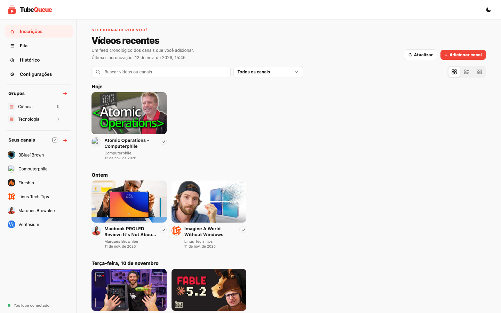

<p align="center">
  
</p>

<h1 align="center">TubeQueue</h1>

<p align="center"><strong>Seus canais do YouTube, dos mais recentes aos mais antigos. Sem algoritmo.</strong></p>

<br>

<p align="center">Um feed privado e auto-hospedado dos canais que você escolher.</p>

<p align="center">
  <a href="README.md">🇺🇸 English</a> ·
  <a href="#comece-rápido">Comece rápido</a> ·
  <a href="LICENSE">Licença MIT</a>
</p>

<p align="center">
  <picture>
    <source media="(prefers-color-scheme: dark)" srcset="docs/screenshots/feed-dark.pt-BR.png">
    
  </picture>
</p>

---

## Recursos

- 📺 **Um feed cronológico** dos canais que você adicionar, agrupado por dia, em grade, lista ou fileiras por canal
- 🚫 **Sem Shorts**, a menos que você queira
- 🔄 **Sincronização em segundo plano** no intervalo que você escolher
- 🗂️ **Grupos de canais** para filtrar o feed por assunto
- ▶️ **Player integrado** com modo teatro e reprodução automática opcional do próximo vídeo, com link para o YouTube para curtir e comentar
- 📋 **Fila de reprodução**: arraste para reordenar, repita e limpe com um clique, opcionalmente flutuante em todas as páginas
- ✅ **Marcação de vídeos vistos** e **histórico** opcional com filtro por data
- 🪶 **Modo econômico** que carrega miniaturas bem mais leves
- 🔎 **Busca instantânea** em vídeos e canais
- 📥 **Importação e exportação** da lista de canais em CSV
- 🌗 **Temas claro e escuro**, em português e inglês
- 🔒 **Privado**: sem login do Google, tudo fica em um arquivo SQLite local

## Comece rápido

**Docker**

```sh
git clone https://github.com/josecarlos19/tube-queue.git tubequeue && cd tubequeue
cp .env.example .env
docker compose up -d --build
```

**Node.js** (versão fixada no `.nvmrc`)

```sh
git clone https://github.com/josecarlos19/tube-queue.git tubequeue && cd tubequeue
nvm install
npm start
```

Abra **<http://127.0.0.1:8070>**. Salve sua chave da API em **Configurações**, clique em **Adicionar canal** e cole o `@handle` ou a URL de um canal.

## Chave da API do YouTube

O TubeQueue lê dados públicos dos canais pela YouTube Data API. A chave é gratuita:

1. No [Google Cloud Console](https://console.cloud.google.com/), ative a **YouTube Data API v3**.
2. Crie uma **chave de API** em **APIs e serviços → Credenciais** e restrinja-a a essa API.
3. Cole a chave em **Configurações** ou defina `YOUTUBE_API_KEY` no `.env`.

A [cota diária gratuita](https://developers.google.com/youtube/v3/getting-started#quota) é mais do que suficiente para um feed pessoal.

## Bom saber

- **Sem login.** O TubeQueue escuta apenas em `127.0.0.1`. Para acessar de outros dispositivos, use um proxy reverso com autenticação.
- **Backup.** Todos os seus dados ficam em `data/`. Pare o app e copie essa pasta.
- **Atualização.** Rode `git pull` e reinicie o app (ou reconstrua o container).
- **Desenvolvimento.** `npm run dev` reinicia o servidor e recarrega a página quando você edita um arquivo.

O TubeQueue não tem vínculo com o YouTube nem com o Google.

## Licença

[MIT](LICENSE)
